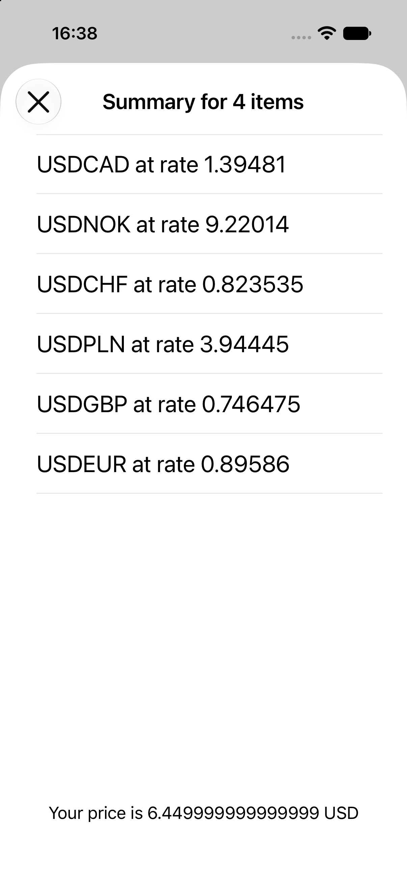
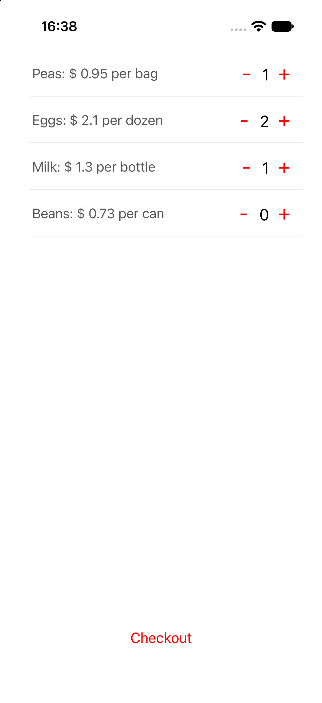

# Shopping iOS Demo

A native iOS shopping app built with Swift and UIKit, demonstrating MVVM, separation of concerns, dependency injection, unit testing, and integration with an external REST API.

The app lets users browse a predefined product list, manage quantities in a shopping basket, view the order summary, and convert the total price from USD to other currencies using live exchange rates.

## Features

- Browse a predefined catalogue of products.
- Add and remove products from the shopping basket.
- Calculate the total price of selected items.
- Display an order summary.
- Fetch live exchange rates from the [APILayer Currency Data API](https://apilayer.com/marketplace/currency_data-api).
- Convert the basket total from USD to the selected currency.

## Architecture

The project follows an MVVM-inspired architecture with clearly separated responsibilities.

- **Views and View Controllers** — render the interface and forward user interactions.
- **ViewModels** — coordinate presentation logic and interact with domain components through protocols.
- **Domain models** — represent shopping items, currencies, and basket operations.
- **Providers** — encapsulate external data access, including HTTP requests and JSON decoding.
- **Protocols and assemblies** — define component boundaries and make dependencies replaceable in tests.

Dependency injection and protocol-based abstractions allow components to be tested in isolation without requiring the real network service.

## Testing

The project contains two separate test targets:

| Target | Purpose |
| --- | --- |
| `ShoppingTests` | Unit tests for basket operations, ViewModels, view controllers, and helper functions. |
| `ShoppingIntegrationTests` | Integration tests that make real HTTP requests to the currency API. |

The unit tests use test doubles, including stubs and spies, to isolate the components under test.

The integration tests verify the currency provider against actual API responses, including successful currency retrieval and handling of an invalid currency request.

**Note:** Integration tests require a valid APILayer API key and an API subscription that supports the requested endpoint and currencies. They will not pass without valid API credentials and a working API response. Unit tests do not require an API key.

## Screenshots

### Shopping list



### Checkout and summary



## Requirements

- macOS and Xcode compatible with the project.
- An iOS Simulator or a compatible physical iOS device.
- Internet access for live exchange rates.
- An APILayer API key to run the integration tests and retrieve live exchange rates.

## Getting Started

### 1. Clone the repository

```bash
git clone https://github.com/bartguminiak/shopping-ios-demo.git
cd shopping-ios-demo
```

### 2. Open the project

Open `Shopping.xcodeproj` in Xcode and allow the project to finish indexing.

### 3. Configure the API key

1. Create an account at [APILayer](https://apilayer.com/).
2. Subscribe to the [Currency Data API](https://apilayer.com/marketplace/currency_data-api) and generate an API key.
3. Open `Shopping/Screens/Summary/Providers/CurrencyRateProvider.swift`.
4. Locate the `yourAPIKey` constant inside the `query` property and provide your own key locally.

The key is intentionally not included in the repository.

**Security:** Do not commit your API key or push it to GitHub. For this legacy demo, the provider reads the key from a source-code constant, so keep the change local. A production application should use an appropriate secrets-management strategy rather than embedding a private API key in a distributed client application.

### 4. Build and run

Select the `Shopping` app scheme, choose an iOS Simulator or connected device, and run the application.

The shopping list and basket functionality can be explored independently of the currency API. Live exchange rates require a valid API key and network access.

## Running the Tests

### Unit tests

In Xcode, select the `ShoppingTests` target or its test scheme and run the tests.

These tests exercise local application logic and use test doubles to avoid external network dependencies.

### Integration tests

The repository includes a shared `ShoppingIntegrationTests` scheme.

1. Configure your APILayer API key as described above.
2. Ensure the API subscription supports the requested currencies and endpoint.
3. Select the `ShoppingIntegrationTests` scheme in Xcode.
4. Run the tests.

Integration tests make real network requests, so their results depend on API credentials, service availability, and the external API's response.

## Project Structure

```text
Shopping/
├── Application/       # Application setup and dependency assembly
├── Commons/           # Basket, item, currency, and shared helpers
└── Screens/
    ├── ShoppingList/  # Product list and basket interactions
    └── Summary/       # Checkout summary and currency conversion

ShoppingTests/         # Unit tests
ShoppingIntegrationTests/
                       # Network integration tests
Shopping.xcodeproj/    # Xcode project and shared test scheme
```

## Technologies

- Swift
- UIKit
- MVVM-inspired presentation architecture
- Protocol-oriented abstractions and dependency injection
- URLSession
- URLComponents and JSONDecoder
- XCTest

## Project Context

This is a demonstration project originally developed in 2017. It is intended to illustrate architectural separation, testability, and API integration in a native iOS application rather than to represent a fully modernized production codebase.

## License

This project is licensed under the MIT License. See [LICENSE](LICENSE) for details.
